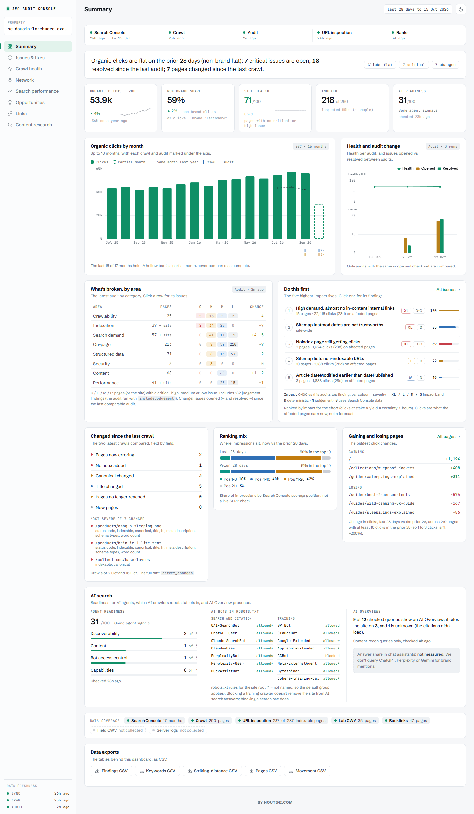
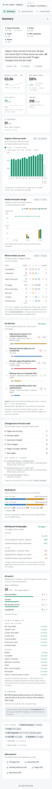
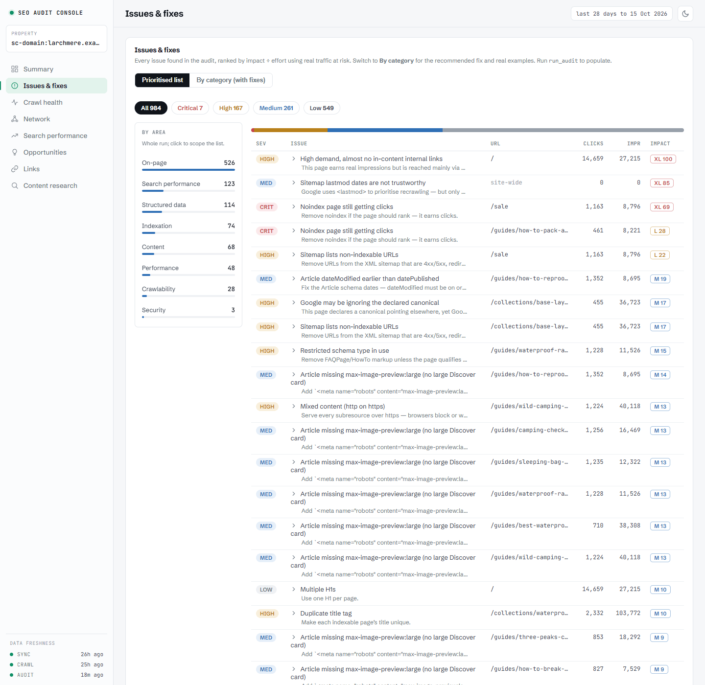
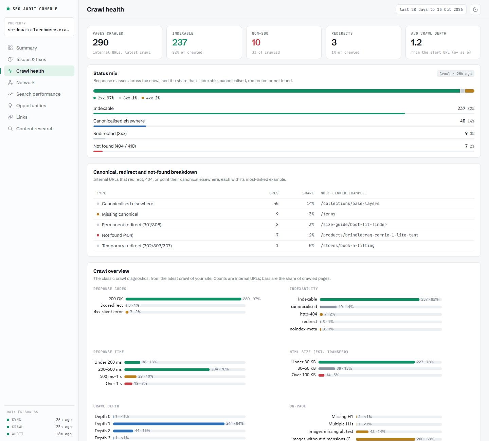
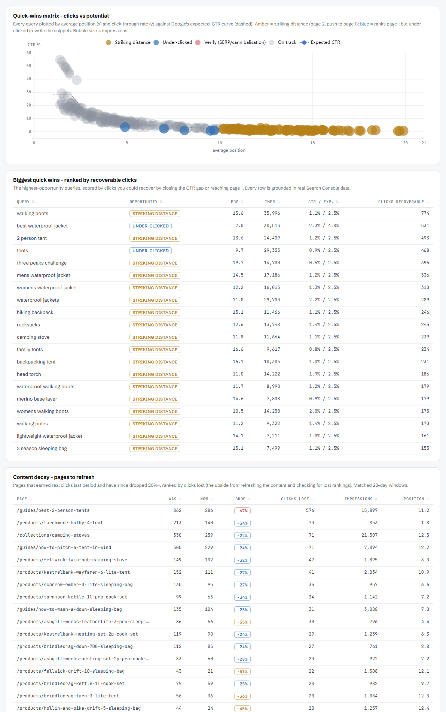
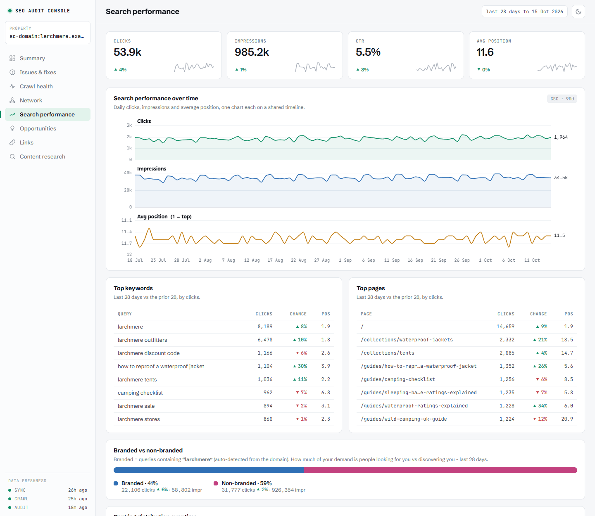
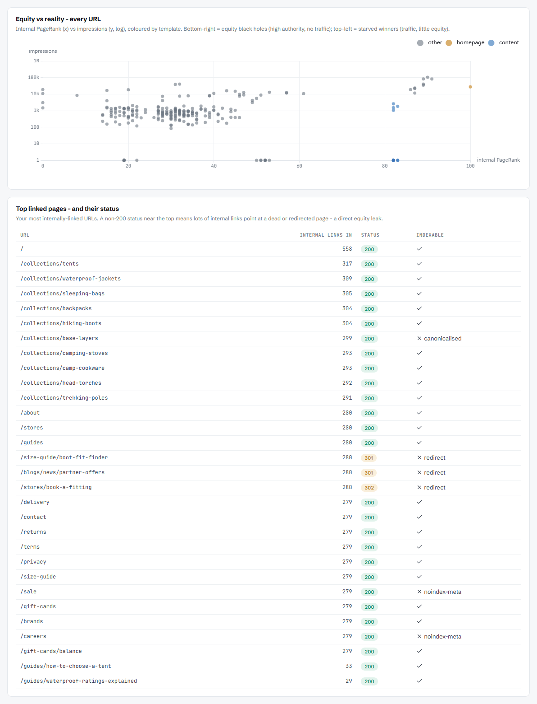
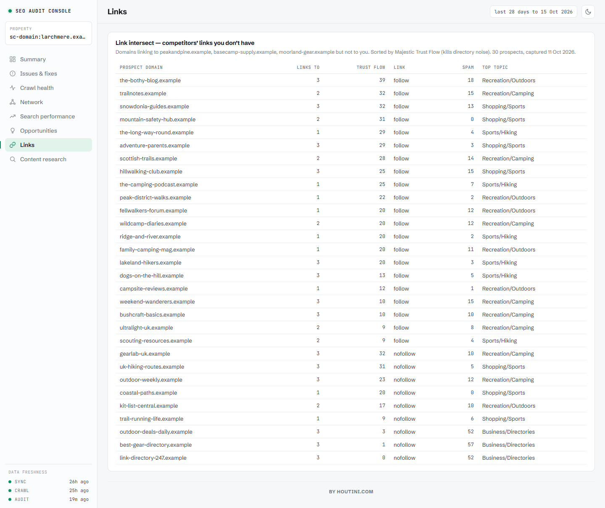
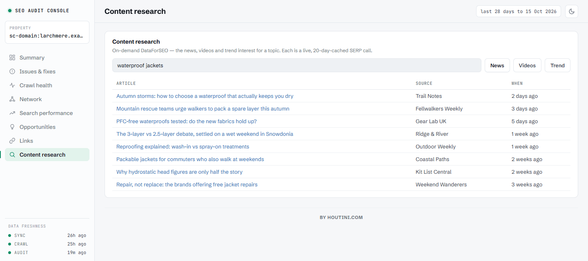

# The dashboard and reports

Two ways to look at everything at once: the interactive dashboard rendered right in the chat (*"show me the dashboard for mysite.com"*), and the same thing exported as a single shareable HTML file (*"export the report"*). Both are built from your synced data, both are organised into eight tabs - with a sidebar to jump straight to any of them - and every number in them traces back to a datapoint in your database.

The dashboard uses a neutral light or dark theme: it follows the host's theme in chat and your system preference in the export, and there's a light/dark toggle in the header if you want to override it. Numbers are tabular and right-aligned throughout, missing values render as a dash rather than a zero, and detail lives in the tooltips rather than on the canvas.

Run `refresh_property` first, and `run_audit` if you want the findings populated. The DataForSEO panels (visibility over time, agent readiness) fill in when you've run the corresponding tools; everything else works from GSC and the crawl alone.

## Summary

The landing tab, and the one to hand someone who has never seen the property. It answers, top to bottom: how fresh is this, how is the site doing, is it better or worse, what's broken, what to do first, and what we don't measure. Every number on it comes from your database; nothing is estimated or written by a model, and anything missing says so in words instead of showing a zero.

- **Freshness** - one line per source (Search Console, crawl, audit, URL inspection, ranks) with its age. A source turns amber on a stated rule, shown in its tooltip: Search Console more than 7 days behind, a crawl or audit older than 30 days, or an audit that ran before the latest crawl (so its findings describe the previous crawl).
- **The verdict** - one sentence built from a template, e.g. *"Organic clicks are down 12% on the prior 28 days (non-brand down 18%); 3 critical issues are open, 14 resolved since the last audit; 27 pages changed since the last crawl."* "Flat" means within ±5%. A clause is left out when its data is missing, so you'll never read "0 critical issues" before an audit has run.
- **Five tiles** - organic clicks (28 days vs the prior 28, year-on-year once you hold 13 months, and a sparkline of complete months), non-brand share, **site health** (the share of crawled pages with no critical or high issue, with its definition; the Weak / Fair / Good / Excellent bands are our convention, not an industry benchmark), indexed pages as *n of M inspected* (URL Inspection is a sample, never a share of the site), and AI readiness.
- **Organic clicks by month** - up to 16 months. The current month is a hollow bar until it's complete, the dashed line is the same month last year (only where both months are complete), and each crawl and audit is ticked under the axis.
- **Health and audit change** - the health score at each audit, and the issues opened and resolved between audits. Two audits are only compared when they ran the same checks over the same scope; otherwise the reason is printed (for example, a release added checks).
- **What's broken, by area** and **Do this first** - the latest audit by category (pages with a critical, high, medium or low issue, and the change since the last comparable audit), next to the five highest-impact fixes with the pages affected, the clicks those pages earn now (not a forecast), the size of the fix and whether the evidence is deterministic (D), judgement (N) or from Search Console (G). Click either to open Issues & fixes filtered to it.
- **Changed since the last crawl** - pages now erroring, noindex added, canonicals and titles changed, pages added or no longer reached: `detect_changes`, summarised. With one crawl it says it needs two; if a newer crawl was never snapshotted, it says the comparison isn't current instead of showing old numbers.
- **Ranking mix** and **gaining and losing pages** - where your impressions sit by average position now vs the prior 28 days, and the biggest click movers among pages with at least 10 clicks in the prior 28 days.
- **AI search** - the agent-readiness score, which AI crawlers your robots.txt lets in (grouped into search and citation bots vs training crawlers: blocking GPTBot, a training crawler, doesn't take you out of ChatGPT search), AI Overview presence as *n of M checked queries* from content recon, and a plain "not measured" for answer share in chat assistants, because we don't query them.
- **Data coverage** - what's held (months of Search Console, crawled pages, URL inspection, lab Core Web Vitals, backlinks) and what isn't collected (field Core Web Vitals, server logs). The CSV exports sit below it.

It works crawl-only: before Search Console is connected, the traffic panels ask you to connect it and everything else still works. If your Search Console history holds two row shapes for the same days (all-country and per-country rows, which double-counts clicks), the Summary says so and counts each day once.

## Issues & fixes

The audit findings, two ways: a **prioritised list** (the same order `run_audit` returns - expected clicks per developer-hour) and a **by-category view with fixes**, where each check groups its affected pages with the remediation attached.

Each finding shows an **impact score (0-100, normalised to the run's biggest finding)** and a **size badge (S / M / L / XL)** rather than a raw clicks forecast. That's deliberate: the underlying model estimates recoverable clicks, but presenting a precise number would read as a promise, and it isn't one. Real measured traffic stays real; estimates stay relative.

## Crawl health

If you grew up on desktop crawlers, this tab is home. Under the KPI strip, the **status mix** (2xx / 3xx / 4xx / 5xx across the crawl, and the share that's indexable, canonicalised, redirected or not found), then the canonical, redirect and not-found breakdown with the most-linked example of each. Then the classic crawl diagnostics as clean stat bars: **response codes**, **indexability reasons** (with the *why* for every non-indexable URL), **response-time** and **HTML-size buckets** (measured on estimated transfer, not raw bytes), **crawl depth**, and title/meta issue counts. Below the bars, the lists: server errors (5xx), pages over a second, and the heaviest images your pages load - sampled from response headers during the crawl, so the image bytes are never downloaded.

It also carries the thematic reports a dedicated crawler would, each appearing when its data is present: **Security & HTTPS** (the share of pages carrying HSTS, CSP, X-Frame, X-Content-Type and Referrer-Policy), **Structured-data coverage** (the JSON-LD rich-result types across your pages), **Redirect chains** (multi-hop redirects captured during the crawl), **Core Web Vitals** (after `page_lighthouse`), and **Hreflang** (declared languages, on multilingual sites).

## Opportunities

Where the growth work lives:

- **Content architecture** - your search demand grouped into topic clusters, each a pillar topic with its supporting sub-topics. Every member is coloured by how well you cover it (green = a page ranks page 1, amber = striking distance, red = a gap with no covering page), with a coverage score per cluster, a funnel read where intent data exists (run `search_intent`), and pillar-to-member internal-link suggestions. **How it works:** the clusters come from your own Search Console demand, not a third-party keyword index - we take the queries you earn impressions for, group them lexically, map each to the page that serves it and the position it holds, classify it covered (ranks ≤10) / thin (11-20, striking distance) / gap (no page ranks), and roll that up into the cluster with its coverage %. It answers "given what my site already covers, what should I strengthen or create next, and where does it fit" - grounded in real demand, inventing nothing.
- **Quick-wins matrix** - current clicks against recoverable potential, per page, so the underpriced fixes jump out.
- **Biggest quick wins** - the same thing as a ranked table.
- **Content decay** - the refresh list: pages losing clicks period-over-period.
- **Keyword cannibalisation** - the competing URLs per query, with each URL's share of the impressions, so the consolidate-or-differentiate call is made on numbers.
- **Cannibalisation over time** - my favourite chart in the product: for a contested query, which URL Google picked, week by week. When the lines braid, Google can't decide, and that's the page pair to fix first.

## Search performance

The Search Console view you wish Google shipped - and because the history lives in your own database, it isn't capped at 16 months:

- **Search performance over time** - daily clicks, impressions and average position as three small charts on one timeline.
- **Top keywords and top pages** - 28 days against the prior 28, by clicks.
- **Branded vs non-branded** clicks split.
- **Ranking distribution over time** - impressions by position bucket, the honest "are we improving" chart.
- **Search visibility over time** - the DataForSEO monthly rank distribution, reconciled with your GSC dates (needs `track_ranks`).
- **Rank & clicks over time**, together on one axis.
- **Top keyword and page performance**, 28 days against the prior 28.
- **Keyword ranking movement** over 90 days - risers and fallers.
- **Breakdowns by device and country** - these appear when you've synced with `segments:true` ([tools.md](tools.md#sync_gsc)).
- **GSC index coverage** - Google's own per-URL index status from URL Inspection (run `inspect_urls`): the coverage-state distribution and any Google-vs-declared canonical conflicts.

Tables export to CSV where you'd want them to.

## Network

The structural story - where your internal link equity goes versus where your traffic comes from:

- **Site network** - a force-directed graph of your internal link skeleton: the top pages by internal PageRank and the in-content links between them. Node size is internal PageRank; colour is health (green indexable, amber non-indexable, red broken or redirected), so a cluster of amber or red high up is a structural problem you can see at a glance. Drag to explore, scroll to zoom, click a node to open the page.
- **Equity flow vs traffic by template** - each template's share of internal PageRank against its share of impressions. A template hoarding equity while earning nothing is a structural decision worth revisiting.
- **Equity vs reality, every URL** - the scatter of internal PageRank against impressions. The corners are the findings: high equity + no traffic (wasted authority), high traffic + no equity (underlinked winners, and the pages a redesign would quietly kill).
- **Top linked pages and their status** - your most internally linked URLs with their live HTTP status. A non-200 high on this list is an equity leak in plain sight.
- **Trapped authority** - pages the web trusts (referring domains, and Majestic **Trust Flow** with its top topic once you've run `pull_backlinks` with a Majestic key) that sit buried deep in your architecture - click depth 3+ from the homepage, or unreachable through the body - so their link equity never reaches your money pages. The fix: link to them from higher up.
- **Agent readiness** - the 0-100 score and category checklist from `check_agent_readiness`, once you've run it.
- **AI answerability** - a local cross-encoder scores whether each ranking page carries a dense, extractable answer for its top query (run `score_passages`). Weakest first; a score under 3 means there's no clear passage an AI can lift. No other tool checks this.
- **Entity & topic graph** - your pages resolved to Wikidata entities (run `resolve_entities`) and the subclass / part-of edges between them - a map of the concepts your site covers.

## Links

Link intersect: the domains linking to your competitors but not to you - a ready-made outreach list. Run `link_intersect` for a property (a DataForSEO Backlinks call) and this fills with the prospects, sorted followed-first then by domain trust. With a **Majestic** key set, each prospect is re-sorted by **Trust Flow** and shows its top topic, so directory noise sinks and genuinely on-topic authority rises. No DataForSEO key? The tab shows a one-click prompt to connect one.

## Content research

On-demand topic research, right in the dashboard: type a keyword and pull recent **News** (free Google News plus DataForSEO), the ranking **Videos** (YouTube SERP), or the **Trend** direction (Google Trends - rising, falling or flat). The "what's being published and who's covering it" panel - each button is a live, 7-day-cached lookup. News works free via Google News; videos and trends use DataForSEO.

## Exporting: `export_report`

> Export the report for mysite.com

Writes the whole dashboard - data and charts inlined - to a single self-contained HTML file in your reports folder (under the data directory, path returned by the tool). Open it in any browser, attach it to an email, hand it to a client; the recipient needs nothing installed and nothing running. It's a snapshot of the moment you exported, so re-export after a refresh when you want current numbers. A `theme` option gives you light or dark.

One honest limitation: the in-chat widget and the export are the same dashboard, so anything the widget can't show (because you haven't synced or run the relevant tool), the export can't either. The export tells you the finding count it shipped with, which is a decent staleness check.
