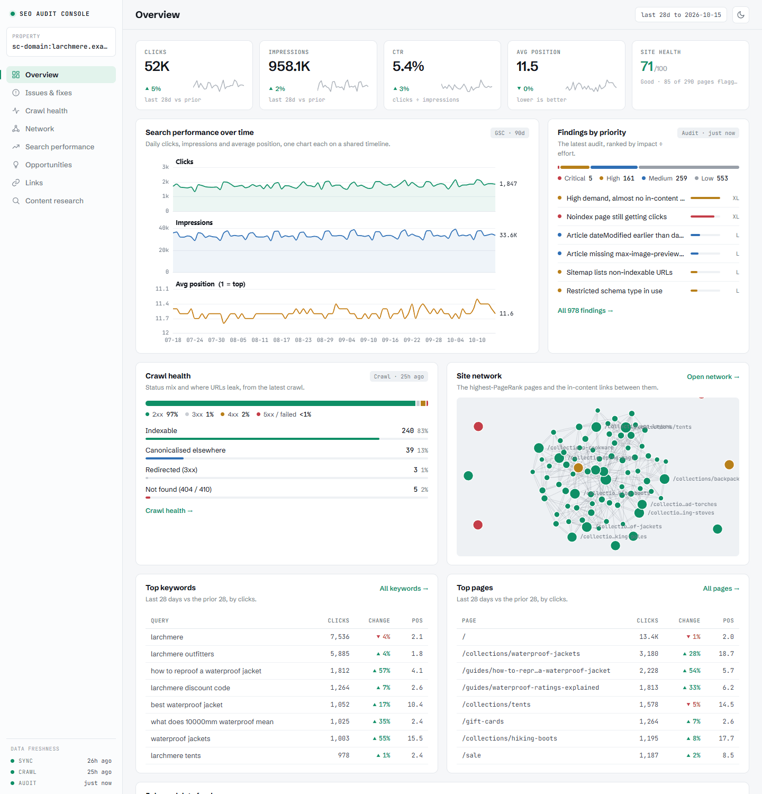

# The dashboard and reports

Three ways to look at everything at once: the interactive dashboard rendered right in the chat (*"show me the dashboard for mysite.com"*), the same dashboard in a browser tab (*"open the dashboard"*), and a single shareable HTML file (*"export the report"*). All three are built from your synced data, all are organised into eight tabs - Overview, Issues & fixes, Crawl health, Network, Search performance, Opportunities, Links and Content research - and every number in them traces back to a datapoint in your database.

A sticky sidebar holds the property, the tab navigation and a data-freshness summary, under a slim top bar. There are two themes, a graphite dark and a cool-paper light, sharing one green accent: the dashboard follows the host's theme in chat, your saved choice or system preference in the browser, and opens light in an export unless you ask for dark. The light/dark toggle in the top bar overrides any of them. Numbers are tabular and right-aligned throughout, missing values render as a dash rather than a zero, and detail lives in the tooltips rather than on the canvas.

Run `refresh_property` first, and `run_audit` if you want the findings populated. Panels that depend on an on-demand tool (search visibility over time from `track_ranks`, agent readiness from `check_agent_readiness`, market sizing, the SERP-feature footprint and so on) fill in once you've run it; everything else works from GSC and the crawl alone.

## In your browser

> Open the dashboard for mysite.com

`open_dashboard` (or `serve_dashboard`) starts a small webserver on `127.0.0.1` and hands you a link. It reads the live database on every load, so it's always current, and it adds a property switcher and working CSV downloads. You rarely need to ask: a finished sync, crawl, inspection or refresh starts it and puts the link in the job's result, and `run_audit` does the same. Set `SAC_AUTOSERVE=0` to stop that automatic start. Two URL options help with sharing and screenshots: `?theme=dark` or `?theme=light` opens in a theme, and `?redact=1` blurs the property name, the traffic figures and the URLs in the tables, and hides the network map's labels.

**Behind the Docker MCP gateway** the MCP server's container publishes no ports, so a link it serves can't be reached from your machine. For that setup there's a standalone dashboard, `seo-audit-dashboard` (`dist/dashboard.js` in the package), which you run as its own container on the same data volume and a fixed, published port:

```bash
docker run -d --name seo-audit-dashboard \
  -p 127.0.0.1:8788:8788 \
  -e SAC_DASHBOARD_BIND=0.0.0.0 -e SAC_DASHBOARD_PORT=8788 -e SAC_DATA_DIR=/data \
  -v seo-audit-data:/data:ro \
  --entrypoint node <your-image> dist/dashboard.js
```

Then open `http://127.0.0.1:8788/`. It serves the identical dashboard from the database the MCP writes, including the job and data-freshness status. Add `-e DATAFORSEO_USERNAME=… -e DATAFORSEO_PASSWORD=…` to light up the Content research tab. Use the volume name you gave the MCP server (see the README's [Docker section](../README.md#docker-and-the-docker-mcp-gateway)); on Git Bash for Windows, prefix the command with `MSYS_NO_PATHCONV=1` so `/data` isn't rewritten into a Windows path. Even bound to `0.0.0.0` inside the container, the server only answers requests addressed to localhost.

## Overview



A **Site Health Score** (0-100, banded Weak / Fair / Good / Excellent) sits in the KPI strip across the top, next to clicks, impressions, CTR and average position - the share of crawled pages with no critical or high finding, defined in plain sight rather than as a black box. Further down, the executive summary: clicks and impressions for the last 28 days against the prior period, the headline finding counts, and the top issues by impact. It's the tab you'd screenshot for a stakeholder - the state of the property in one screen. Between the KPI strip and the summary sit search performance over time (clicks, impressions and average position as three small charts on one timeline), findings by priority, the crawl-health status mix, a site-network preview, top keywords and pages (28 days against the prior 28), and a jobs and data-freshness panel showing what each source last wrote to the database - including a job that was interrupted rather than finished.

## Issues & fixes


The audit findings, two ways: a **prioritised list** (the same order `run_audit` returns - expected clicks per developer-hour) and a **by-category view with fixes**, where each check groups its affected pages with the remediation attached. Severity chips and a by-area filter narrow either view.

Each finding shows an **impact score (0-100, normalised to the run's biggest finding)** and a **size badge (S / M / L / XL)** rather than a raw clicks forecast. That's deliberate: the underlying model estimates recoverable clicks, but presenting a precise number would read as a promise, and it isn't one. Real measured traffic stays real; estimates stay relative.

## Crawl health


If you grew up on desktop crawlers, this tab is home. It opens with a KPI strip (pages crawled, indexable, non-200, redirects, average crawl depth) and a **canonical, redirect and not-found breakdown**: the internal URLs that redirect, 404 or canonicalise elsewhere, each bucket with its most-linked example. Then the classic crawl diagnostics as clean stat bars: **response codes**, **indexability reasons** (with the *why* for every non-indexable URL), **response-time** and **HTML-size buckets** (measured on estimated transfer, not raw bytes), **crawl depth**, and title/meta issue counts. Below the bars, the lists: server errors (5xx), pages over a second, and the heaviest images your pages load - sampled from response headers during the crawl, so the image bytes are never downloaded.

It also carries the thematic reports a dedicated crawler would, each appearing when its data is present: **Security & HTTPS** (the share of pages carrying HSTS, CSP, X-Frame, X-Content-Type and Referrer-Policy), **Structured-data coverage** (the JSON-LD rich-result types across your pages), **Redirect chains** (multi-hop redirects captured during the crawl), **Core Web Vitals** (after `page_lighthouse`), and **Hreflang** (declared languages, on multilingual sites).

## Opportunities


Where the growth work lives:

- **Content architecture** - your search demand grouped into topic clusters, each a pillar topic with its supporting sub-topics. Every member is coloured by how well you cover it (green = a page ranks page 1, amber = striking distance, red = a gap with no covering page), with a coverage score per cluster, a funnel read where intent data exists (run `search_intent`), and pillar-to-member internal-link suggestions. **How it works:** the clusters come from your own Search Console demand, not a third-party keyword index - we take the queries you earn impressions for, group them lexically, map each to the page that serves it and the position it holds, classify it covered (ranks ≤10) / thin (11-20, striking distance) / gap (no page ranks), and roll that up into the cluster with its coverage %. It answers "given what my site already covers, what should I strengthen or create next, and where does it fit" - grounded in real demand, inventing nothing.
- **Quick-wins matrix** - current clicks against recoverable potential, per page, so the underpriced fixes jump out.
- **Biggest quick wins** - the same thing as a ranked table.
- **Market sizing** - share of voice per topic cluster against your named competitors (after `market_sizing`).
- **SERP-feature footprint** - how much of your keyword volume carries AI Overviews, featured snippets, People Also Ask and the rest, split by whether you're on page 1 (after `serp_features`).
- **Content decay** - the refresh list: pages losing clicks period-over-period.
- **Keyword cannibalisation** - the competing URLs per query, with each URL's share of the impressions, so the consolidate-or-differentiate call is made on numbers.
- **Cannibalisation over time** - my favourite chart in the product: for a contested query, which URL Google picked, week by week. When the lines braid, Google can't decide, and that's the page pair to fix first.

## Search performance


The Search Console view you wish Google shipped - and because the history lives in your own database, it isn't capped at 16 months:

- **Branded vs non-branded** clicks split.
- **Ranking distribution over time** - impressions by position bucket, the honest "are we improving" chart.
- **Search visibility over time** - the DataForSEO monthly rank distribution, with the keyword count and estimated traffic value as separate small charts rather than a dual axis, reconciled with your GSC dates (needs `track_ranks`).
- **Rank & clicks over time** - average position and clicks as two small charts on one shared timeline.
- **Top keyword and page performance**, 28 days against the prior 28.
- **Keyword ranking movement** over 90 days - risers and fallers.
- **Breakdowns by device and country** - these appear when you've synced with `segments:true` ([tools.md](tools.md#sync_gsc)).
- **GSC index coverage** - Google's own per-URL index status from URL Inspection (run `inspect_urls`): the coverage-state distribution and any Google-vs-declared canonical conflicts.

Tables export to CSV where you'd want them to.

## Network


The structural story - where your internal link equity goes versus where your traffic comes from:

- **Site network** - a force-directed graph of your internal link skeleton: the top pages by internal PageRank and the in-content links between them. Node size is internal PageRank; colour is health (green indexable, amber non-indexable, red broken or redirected), so a cluster of amber or red high up is a structural problem you can see at a glance. Drag to explore, scroll to zoom, click a node to open the page.
- **Equity flow vs traffic by template** - each template's share of internal PageRank against its share of impressions. A template hoarding equity while earning nothing is a structural decision worth revisiting.
- **Where link equity flows, folder to folder** - a Sankey of internal PageRank moving between site sections, so you can see which sections feed which.
- **Equity vs reality, every URL** - the scatter of internal PageRank against impressions. The corners are the findings: high equity + no traffic (wasted authority), high traffic + no equity (underlinked winners, and the pages a redesign would quietly kill).
- **Top linked pages and their status** - your most internally linked URLs with their live HTTP status. A non-200 high on this list is an equity leak in plain sight.
- **Trapped authority** - pages the web trusts (referring domains from `pull_backlinks`, plus Majestic **Trust Flow** and its top topic when `MAJESTIC_API_KEY` is set during the pull) that sit buried deep in your architecture - click depth 3+ from the homepage, or unreachable through the body - so their link equity never reaches your money pages. The fix: link to them from higher up.
- **Agent readiness** - the 0-100 score and category checklist from `check_agent_readiness`, once you've run it.
- **AI answerability** - a local cross-encoder scores whether each ranking page carries a dense, extractable answer for its top query (run `score_passages`). Weakest first; a score under 3 means there's no clear passage an AI can lift. No other tool checks this.
- **Entity & topic graph** - your pages resolved to Wikidata entities (run `resolve_entities`) and the subclass / part-of edges between them - a map of the concepts your site covers.

## Links


Link intersect: the domains linking to your competitors but not to you - a ready-made outreach list. Run `link_intersect` for a property (a DataForSEO Backlinks call) and this fills with the prospects, sorted followed-first then by domain trust. With a **Majestic** key set, each prospect is re-sorted by **Trust Flow** and shows its top topic, so directory noise sinks and genuinely on-topic authority rises. No DataForSEO key? The tab shows a one-click prompt to connect one.

## Content research


On-demand topic research, right in the dashboard: type a keyword and pull recent **News** (free Google News plus DataForSEO), the ranking **Videos** (YouTube SERP), or the **Trend** direction (Google Trends - rising, falling or flat). The "what's being published and who's covering it" panel - each button is a live lookup, and the DataForSEO calls are cached for 20 days. The tab needs DataForSEO credentials (without them it shows a prompt to connect an account), and research only runs in the live dashboard, not in an export. In chat, `news_discovery` works free via Google News alone.

## Exporting: `export_report`

> Export the report for mysite.com

Writes the whole dashboard - data and charts inlined - to a single self-contained HTML file in your reports folder (under the data directory, path returned by the tool). Open it in any browser, attach it to an email, hand it to a client; the recipient needs nothing installed and nothing running. It's a snapshot of the moment you exported, so re-export after a refresh when you want current numbers. A `theme` option gives you light or dark.

One honest limitation: the in-chat widget and the export are the same dashboard, so anything the widget can't show (because you haven't synced or run the relevant tool), the export can't either. The export tells you the finding count it shipped with, which is a decent staleness check.
